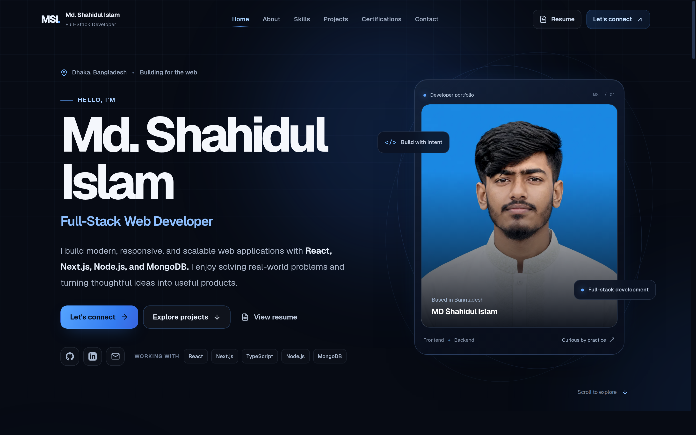
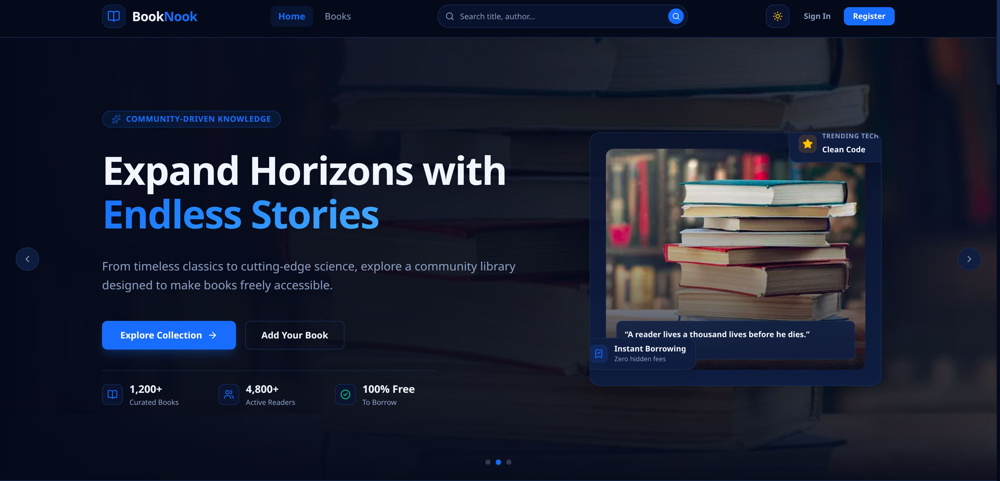
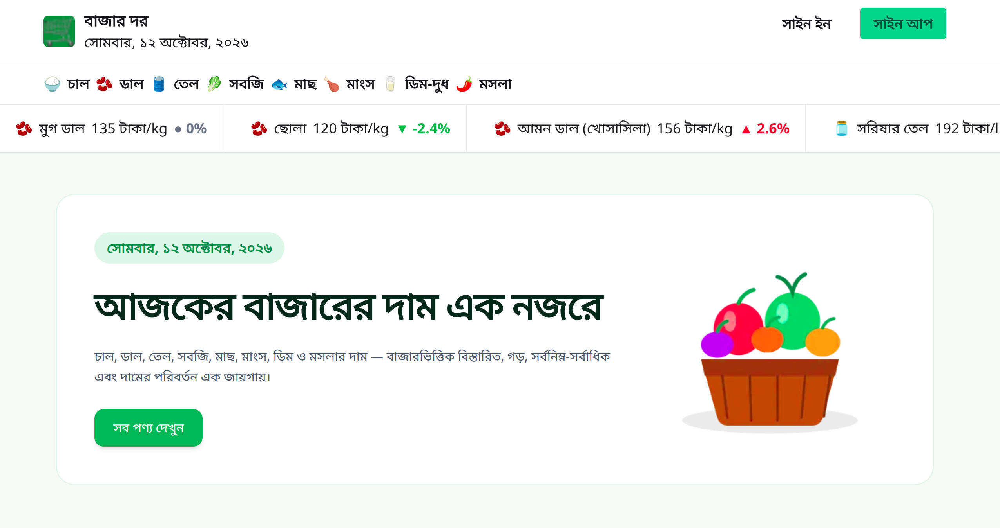

<div align="center">

# MD Shahidul Islam

### Full-Stack Web Developer

Building modern, responsive, and high-performance web applications with **React**, **Next.js**, **Node.js**, and **MongoDB**.


**[🌐 Live Portfolio](https://md-shahidul-portfolio.vercel.app/)** ·
**[📄 Resume](https://md-shahidul-portfolio.vercel.app/resume)** ·
**[💼 LinkedIn](https://www.linkedin.com/in/shahidul91325/)** ·
**[🐙 GitHub](https://github.com/shahidul91325)**

</div>



---

## 👨‍💻 About Me

Hi, I'm **MD Shahidul Islam**, a Full-Stack Web Developer based in **Dhaka, Bangladesh**. I enjoy building responsive, accessible, and user-friendly web applications and solving real-world problems through technology.

I focus on writing clean, maintainable code with modern JavaScript, React, Next.js, and Node.js — from dynamic dashboards and authentication flows to fine-tuned micro-interactions across devices. I'm continuously refining my skills in frontend and backend development, API security, and accessible UI design while building practical products.

- 📍 **Location:** Dhaka, Bangladesh
- 💼 **Focus:** Full-Stack Web Development
- 📧 **Email:** [mdshahidulislam91325@gmail.com](mailto:mdshahidulislam91325@gmail.com)

---

## 🛠️ Technical Skills

| Category | Skills |
| --- | --- |
| 🎨 **Frontend Development** | HTML5, CSS3, JavaScript, TypeScript, React.js, Next.js, Tailwind CSS |
| 🧩 **UI & Component Libraries** | shadcn/ui, HeroUI |
| ⚙️ **Backend Development** | Node.js, Express.js, REST API Development |
| 🗄️ **Database & Authentication** | MongoDB, Better Auth, JWT Authentication |
| 🧠 **Programming Concepts** | OOP, API Integration, Authentication & Authorization, Data Validation |
| 🤖 **AI-Assisted Development** | AI-assisted coding, Prompt Engineering, Cursor AI, Claude Code, Lovable, Bolt |

---

## 🚀 Featured Projects

### 📚 BookNook — Online Library Management Platform

A full-stack online library platform for discovering books, managing collections, and borrowing or returning books with inventory tracking.



**Key features**

- Email/password and Google authentication with Better Auth
- Book catalog with search, category filtering, and new arrivals
- Add, edit, and delete books with detail and availability views
- Borrow and return workflow with available-copy tracking and duplicate-borrowing prevention
- Dark and light theme with a fully responsive interface

**Stack:** Next.js, React, TypeScript, Tailwind CSS, Node.js, Express.js, MongoDB, Better Auth, JWT, Zod

**Links:** [🌐 Live Demo](https://book-nook-web.vercel.app/) · [💻 Frontend](https://github.com/shahidul91325/BookNook-Web) · [🗄️ Backend](https://github.com/shahidul91325/BookNook-Backend) · [📖 Case Study](https://md-shahidul-portfolio.vercel.app/projects/booknook)

---

### 🛒 Bazar Dor — Essential Product Price Tracker

A Bangladesh-focused web application for browsing essential products, categories, price movement, and market-level price information.



**Key features**

- Browse products through categories with price-based sorting
- Separate views for products with rising and falling prices
- Product details with market-specific minimum, maximum, and average prices
- Email/password, Google, and GitHub authentication using Better Auth
- Authenticated profile viewing and name updates

**Stack:** Next.js, React, TypeScript, Tailwind CSS, DaisyUI, MongoDB, Better Auth

**Links:** [🌐 Live Demo](https://bazar-dor-web.vercel.app/) · [💻 Source Code](https://github.com/shahidul91325/Bazar-Dor-Web) · [📖 Case Study](https://md-shahidul-portfolio.vercel.app/projects/bazar-dor)

---

## ⚙️ Built With

This portfolio is engineered with:

- **[Next.js 16](https://nextjs.org/)** (App Router) and **React 19** — fast, SEO-friendly pages with static generation for every route
- **Tailwind CSS 4** — design-token-driven dark theme
- **React View Transitions** — smooth directional page transitions
- **IntersectionObserver scroll reveals** — lightweight staggered entrance animations, no animation library required
- **lucide-react** icon set
- **Formspree** contact form with client-side validation
- Hosted on **[Vercel](https://vercel.com/)** with ESLint enforced in CI-style checks

---

## ✨ Portfolio Highlights

- 📱 **Fully responsive** — verified across mobile, tablet, laptop, and wide desktop viewports
- 🧭 **Smart navigation** — sticky navbar with route- and scroll-aware active section highlighting, including project detail pages
- 🎞️ **Polished motion** — page transitions, staggered entrances, and scroll-triggered reveals
- ♿ **Accessible by design** — semantic landmarks, ARIA attributes, keyboard-friendly menus, and `prefers-reduced-motion` support
- 📄 **Online resume** — view or download the resume directly in the browser
- 🔍 **SEO ready** — per-page metadata, Open Graph tags, and statically generated project routes
- 📬 **Contact form** — validated form with copy-to-clipboard contact details and clear success/error states

---

## 🎓 Professional Development

**Programming Hero — AI-Driven Full Stack Engineering** · Batch 14A · ✅ *Completed*

A completed full-stack engineering program focused on practical, project-based learning and AI-assisted development workflows.

---

## 🏁 Getting Started

Run the portfolio locally:

```bash
git clone https://github.com/shahidul91325/shahidul-portfolio.git
cd shahidul-portfolio
npm install
npm run dev
```

Open [http://localhost:3000](http://localhost:3000) in your browser.

Optional — configure the contact form in `.env.local`:

```env
NEXT_PUBLIC_FORMSPREE_ENDPOINT=your_formspree_endpoint
```

Production build and lint:

```bash
npm run build
npm run lint
```

---

## 📬 Contact

I'm open to connecting with developers, collaborating on projects, and discussing full-stack web development opportunities.

- 📧 **Email:** [mdshahidulislam91325@gmail.com](mailto:mdshahidulislam91325@gmail.com)
- 💼 **LinkedIn:** [shahidul91325](https://www.linkedin.com/in/shahidul91325/)
- 🐙 **GitHub:** [shahidul91325](https://github.com/shahidul91325)
- 🌐 **Portfolio:** [md-shahidul-portfolio.vercel.app](https://md-shahidul-portfolio.vercel.app/)

---

<div align="center">

⭐ If you find my work interesting, feel free to explore the repositories and share your feedback.

**Built with passion by MD Shahidul Islam.**

</div>
